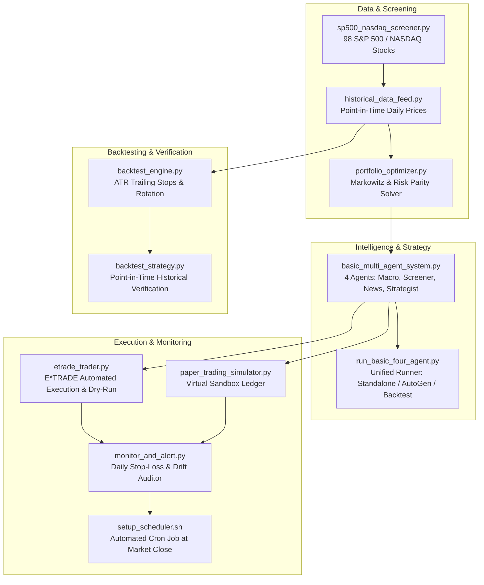

# Institutional Trading Strategy: Complete Scripts Execution Guide

This document is a comprehensive operational manual for running every script in the trading strategy platform. It covers multi-agent intelligence, quantitative screening, point-in-time backtesting, automated brokerage execution (E*TRADE & paper trading), and daily risk monitoring.

---

## 🚀 1. Quick Start Cheat Sheet

| Task | Primary Command | Description |
| :--- | :--- | :--- |
| **Run 4-Agent Analysis** | `python3 basic_multi_agent_system.py` | Generates full institutional committee dossier and 15-stock target allocation matrix. |
| **Backtest Strategy (1-Year)** | `python3 backtest_strategy.py --lookback 1y` | Backtests the multi-asset strategy over the trailing 1-year window against SPY, QQQ, VTI. |
| **Backtest Strategy (2-Year)** | `python3 backtest_strategy.py --lookback 2y` | Backtests over 2 years with point-in-time screening, ATR stops, and quarterly rotation. |
| **E\*TRADE Simulation ($10k)** | `python3 etrade_trader.py --balance 10000 --dry-run` | Previews whole-share order tickets and capital allocation for an E*TRADE account. |
| **Live Daily Risk Audit** | `python3 monitor_and_alert.py` | Audits positions against trailing stops, take-profit thresholds, and portfolio drift. |
| **Screen Market Outperformers** | `python3 sp500_nasdaq_screener.py` | Filters 98 S&P 500 / NASDAQ 100 stocks beating benchmark CAGR averages. |

---

## 🔄 2. End-to-End System Architecture



---

## 📋 3. Detailed Guide to Every Script

### 3.1. Multi-Agent Intelligence & Research

#### 1. [`basic_multi_agent_system.py`](file:///Users/guihua/workspace/tradingStrategy/basic_multi_agent_system.py)
- **Purpose**: Core 4-agent institutional research pipeline mimicking a top hedge fund investment committee.
- **Agents Invoked**:
  1. `Macro_Economic_Analyst`: Assesses inflation, GDP, interest rates, and macro regime.
  2. `Alpha_Stock_Screener`: Filters secular compounders beating S&P 500 and NASDAQ 100 over 2-year horizons.
  3. `Company_News_Analyst`: Analyzes headline sentiment and corporate catalysts for top holdings.
  4. `Investment_Strategist`: Computes optimal Markowitz portfolio weights, sector caps, and risk policies.
- **How to Run**:
  ```bash
  python3 basic_multi_agent_system.py
  ```
- **Output**: Full Markdown Investment Committee Dossier printed to terminal, including target weight matrix and execution policies.

---

#### 2. [`run_basic_four_agent.py`](file:///Users/guihua/workspace/tradingStrategy/run_basic_four_agent.py)
- **Purpose**: Unified CLI orchestrator supporting deterministic financial models, AutoGen LLM GroupChat, and backtesting shortcuts.
- **Key Options**:
  - `--years 10` or `--years 20`: Historical screener comparison window.
  - `--symbol TICKER`: Focuses news analysis and strategic memo on a specific ticker (e.g. `NVDA`, `MSFT`).
  - `--autogen`: Launches interactive multi-agent debate using OpenAI API (requires `OPENAI_API_KEY`).
  - `--backtest`: Runs an integrated historical backtest.
- **Examples**:
  ```bash
  # Standard deterministic pipeline (default):
  python3 run_basic_four_agent.py

  # Focus news and operations on NVDA:
  python3 run_basic_four_agent.py --symbol NVDA

  # Run backtest via the unified runner:
  python3 run_basic_four_agent.py --backtest --lookback 2y --capital 100000 --top-n 15

  # Run AutoGen LLM GroupChat mode (if OpenAI API key is set):
  export OPENAI_API_KEY="sk-..."
  python3 run_basic_four_agent.py --autogen --symbol MSFT
  ```

---

#### 3. [`sp500_nasdaq_screener.py`](file:///Users/guihua/workspace/tradingStrategy/sp500_nasdaq_screener.py)
- **Purpose**: Quantitative screening engine tracking 98 constituent companies across the S&P 500 and NASDAQ 100.
- **Features**:
  - Evaluates dual-hurdle benchmarks: S&P 500 (`SPY`) and NASDAQ 100 (`QQQ`).
  - Supports **Point-in-Time as-of-date screening** (`as_of_date`), preventing look-ahead bias in backtests.
- **How to Run**:
  ```bash
  python3 sp500_nasdaq_screener.py
  ```
- **Output**: Ranked table of market-beating stocks with 2-year CAGR, 2-year total returns, and excess alpha over SPY and QQQ.

---

#### 4. [`portfolio_optimizer.py`](file:///Users/guihua/workspace/tradingStrategy/portfolio_optimizer.py)
- **Purpose**: Quantitative asset allocation solver computing Markowitz Mean-Variance Max Sharpe and Risk Parity weights.
- **Features**:
  - Dynamically retrieves asset return/volatility metrics.
  - Dynamically scales single-stock concentration bounds: $\text{Max Weight} = \max(0.12, \frac{2.15}{N})$.
- **How to Run**:
  ```bash
  python3 portfolio_optimizer.py
  ```
- **Output**: Optimization report displaying Max Sharpe weights, portfolio expected return, volatility, and benchmark comparison.

---

#### 5. [`run_strategy.py`](file:///Users/guihua/workspace/tradingStrategy/run_strategy.py)
- **Purpose**: Single-stock institutional valuation and debate pipeline (Reverse DCF, Bull vs. Bear Red Team, Pairs Hedging).
- **Key Options**:
  - `--symbol TICKER`: Target ticker symbol (default: `NVDA`).
  - `--equity AMOUNT`: Portfolio capital (default: `100000`).
  - `--save-memo`: Saves output to `memo_<SYMBOL>.md`.
- **Examples**:
  ```bash
  python3 run_strategy.py --symbol NVDA
  python3 run_strategy.py --symbol MSFT --equity 250000
  ```

---

### 3.2. Historical Backtesting Engine (Zero Look-Ahead Bias)

#### 6. [`backtest_strategy.py`](file:///Users/guihua/workspace/tradingStrategy/backtest_strategy.py)
- **Purpose**: Primary CLI runner for historical strategy simulation.
- **Key Features**:
  - **Point-in-Time Outperformer Selection**: Evaluates candidate compounders strictly as of the backtest start date.
  - **Adaptive $4.0 \times \text{ATR}_{14}$ Trailing Stops**: Protects capital while preventing false whipsaws (bounded 10%–25%).
  - **Quarterly Walk-Forward Rotation**: Rotates out decaying laggards every 60 trading days into newly screened leaders.
  - **Side-by-Side Benchmark Scorecard**: Compares returns, CAGR, volatility, Sharpe ratio, and max drawdown against VTI, QQQ, and SPY.
- **CLI Arguments**:
  - `--lookback`: Window string, e.g. `1y`, `2y`, `3y`, `6m` (default: `1y`).
  - `--start-date` / `--end-date`: Explicit calendar window (`YYYY-MM-DD`).
  - `--capital`: Starting cash (default: `$100,000`).
  - `--top-n`: Number of diversified holdings (default: `15`).
  - `--trailing-stop`: Base trailing stop threshold (default: `0.20` = 20%).
  - `--take-profit`: Take-profit trim threshold (default: `0.50` = 50%).
  - `--rebalance-days`: Walk-forward rebalance interval (default: `60` days).
  - `--symbols`: Explicit list of tickers (e.g. `NVDA,MSFT,AAPL`); if omitted, screener selects top compounders point-in-time.
- **Examples**:
  ```bash
  # 1-Year Backtest with 15 cross-sector holdings:
  python3 backtest_strategy.py --lookback 1y

  # 2-Year Backtest with point-in-time universe selection:
  python3 backtest_strategy.py --lookback 2y

  # Custom calendar window with $50,000 capital:
  python3 backtest_strategy.py --start-date 2025-01-01 --end-date 2026-06-30 --capital 50000

  # Single-stock backtest:
  python3 backtest_strategy.py --lookback 2y --symbols NVDA
  ```

---

#### 7. [`historical_data_feed.py`](file:///Users/guihua/workspace/tradingStrategy/historical_data_feed.py)
- **Purpose**: Market price provider. Downloads real OHLCV data via `yfinance` when available, with a continuous offline geometric Brownian bridge matching exact verified calendar prices across multi-year horizons.
- **How to Test**:
  ```bash
  python3 historical_data_feed.py
  ```

---

### 3.3. Brokerage Execution (E*TRADE & Paper Trading)

#### 8. [`etrade_trader.py`](file:///Users/guihua/workspace/tradingStrategy/etrade_trader.py)
- **Purpose**: Automated brokerage execution connecting multi-agent targets directly to an **E*TRADE account** ($10,000 balance support).
- **Features**:
  - **Dry-Run Mode**: Simulates all order tickets before placing trades.
  - **Whole-Share Integer Lot Optimization**: Resolves odd lots and minimizes idle cash drag (allocates ~97.5% of capital with a ~2.5% cash buffer).
  - **OAuth 1.0a Session Manager**: Interactive verification flow with cached credentials.
- **CLI Arguments**:
  - `--balance AMOUNT`: Starting investment capital (default: `10000`).
  - `--dry-run`: Simulation mode without sending orders (default: `True`).
  - `--live`: Enables live order placement (disables dry-run).
  - `--auth`: Launches interactive OAuth 1.0a authorization PIN flow.
  - `--sandbox` / `--production`: Selects E*TRADE Sandbox vs. Production.
  - `--top-n`: Number of diversified holdings (default: `15`).
- **Examples**:
  ```bash
  # 1. Preview simulated order tickets for a $10,000 account (Dry-Run):
  python3 etrade_trader.py --balance 10000 --dry-run

  # 2. Authorize your E*TRADE account (one-time setup):
  python3 etrade_trader.py --auth

  # 3. Preview and submit orders to Sandbox:
  python3 etrade_trader.py --balance 10000 --sandbox --live

  # 4. Submit orders to Live Production account:
  python3 etrade_trader.py --balance 10000 --production --live
  ```

---

#### 9. [`paper_trading_simulator.py`](file:///Users/guihua/workspace/tradingStrategy/paper_trading_simulator.py)
- **Purpose**: Local virtual brokerage sandbox tracking orders, cash, positions, unrealized PnL, and executed trade history in [`virtual_portfolio.json`](file:///Users/guihua/workspace/tradingStrategy/virtual_portfolio.json).
- **Features**: Realistic slippage model (0.05%), position tracking, and disk persistence.

---

#### 10. [`alpaca_paper_trader.py`](file:///Users/guihua/workspace/tradingStrategy/alpaca_paper_trader.py)
- **Purpose**: Connector for Alpaca Free Paper Trading Platform ($100k virtual buying power).
- **Requirements**: Set `APCA_API_KEY_ID` and `APCA_API_SECRET_KEY` in environment.

---

### 3.4. Monitoring, Alerts & Automation

#### 11. [`monitor_and_alert.py`](file:///Users/guihua/workspace/tradingStrategy/monitor_and_alert.py)
- **Purpose**: Automated daily risk auditor. Evaluates active portfolio positions against adaptive trailing stops, take-profit levels, and portfolio drift.
- **CLI Arguments**:
  - `--simulate TICKER=PRICE`: Simulates a market shock to verify stop-loss trigger logic (e.g. `--simulate NVDA=115`).
  - `--save-log`: Appends alert logs to [`alerts.log`](file:///Users/guihua/workspace/tradingStrategy/alerts.log).
- **Examples**:
  ```bash
  # Normal daily audit:
  python3 monitor_and_alert.py

  # Test stop-loss alert with simulated price drop:
  python3 monitor_and_alert.py --simulate NVDA=115 --save-log
  ```

---

#### 12. [`setup_scheduler.sh`](file:///Users/guihua/workspace/tradingStrategy/setup_scheduler.sh)
- **Purpose**: Shell script configuring a system `cron` job on macOS or Linux to run [`monitor_and_alert.py`](file:///Users/guihua/workspace/tradingStrategy/monitor_and_alert.py) automatically every weekday at market close (4:05 PM Eastern).
- **How to Run**:
  ```bash
  bash setup_scheduler.sh
  ```

---

## 🛠️ 4. Recommended Operational Workflow

### Step 1: Research & Target Portfolio Generation
Run the multi-agent intelligence system to assess macroeconomic conditions and identify the current 15 cross-sector compounders:
```bash
python3 basic_multi_agent_system.py
```

### Step 2: Historical Strategy Validation
Verify how the strategy would have performed over the past 1 and 2 years without lookahead bias:
```bash
python3 backtest_strategy.py --lookback 1y
python3 backtest_strategy.py --lookback 2y
```

### Step 3: Broker Execution (Preview First)
Generate the exact whole-share order tickets for your $10,000 account:
```bash
python3 etrade_trader.py --balance 10000 --dry-run
```
When ready to execute:
1. Configure credentials in [`.env`](file:///Users/guihua/workspace/tradingStrategy/.env.example).
2. Authorize via `python3 etrade_trader.py --auth`.
3. Submit live orders via `python3 etrade_trader.py --balance 10000 --live`.

### Step 4: Daily Post-Market Risk Management
Run daily after market close (or let `cron` run automatically):
```bash
python3 monitor_and_alert.py --save-log
```

---

## 🔐 5. Configuration & Environment Variables

Copy [`.env.example`](file:///Users/guihua/workspace/tradingStrategy/.env.example) to `.env` to configure API keys:

```bash
cp .env.example .env
```

| Variable | Required For | Description |
| :--- | :--- | :--- |
| `ETRADE_CONSUMER_KEY` | [`etrade_trader.py`](file:///Users/guihua/workspace/tradingStrategy/etrade_trader.py) | E*TRADE API consumer key |
| `ETRADE_CONSUMER_SECRET` | [`etrade_trader.py`](file:///Users/guihua/workspace/tradingStrategy/etrade_trader.py) | E*TRADE API consumer secret |
| `ETRADE_SANDBOX` | [`etrade_trader.py`](file:///Users/guihua/workspace/tradingStrategy/etrade_trader.py) | Set to `true` for paper testing |
| `APCA_API_KEY_ID` | [`alpaca_paper_trader.py`](file:///Users/guihua/workspace/tradingStrategy/alpaca_paper_trader.py) | Alpaca paper trading API key |
| `APCA_API_SECRET_KEY` | [`alpaca_paper_trader.py`](file:///Users/guihua/workspace/tradingStrategy/alpaca_paper_trader.py) | Alpaca paper trading secret key |
| `OPENAI_API_KEY` | `run_basic_four_agent.py --autogen` | OpenAI API key for AutoGen LLM chat |

